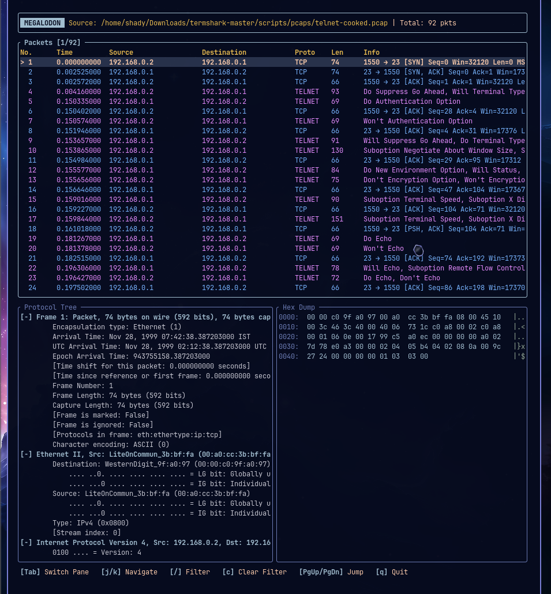
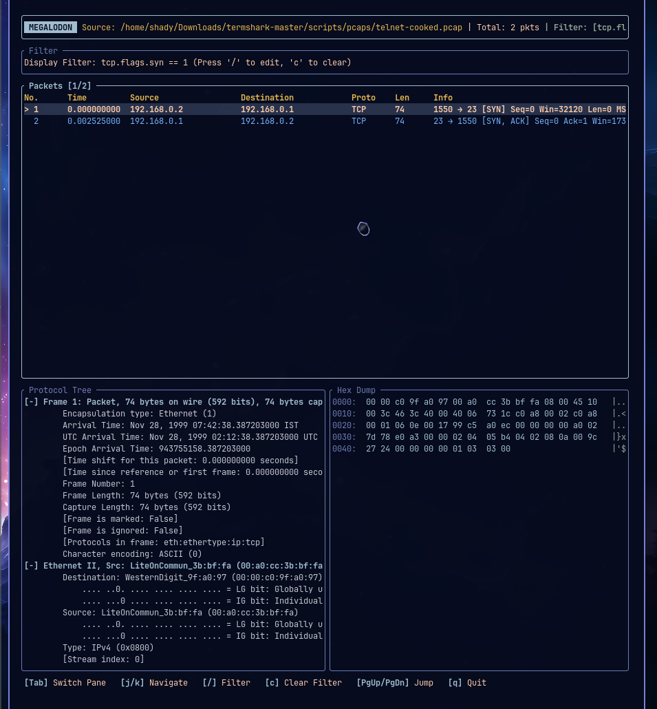

# megalodon

so basically wireshark in your terminal, but actually fast and doesn't lag your machine.



## why did i make this?

honestly i liked termshark's idea a lot, but it was written in older go with a bunch of heavy xml parsing under the hood, and whenever you threw a decent sized pcap at it or scrolled fast it felt sluggish as hell.

so i rewrote the whole thing in rust using ratatui. it connects right to tshark, parses what it needs with zero garbage collector pauses, sits at like ~15mb of ram, and feels butter smooth at 60fps.

also megalodon is just a way cooler name than termshark lol.

## what it does

- **3-pane layout just like wireshark**:
  - top: full packet list with color coded protocols (tcp in blue, telnet/ssh in purple, dns/udp in cyan, errors in red, etc.)
  - bottom left: collapsible protocol tree that breaks down every layer down to individual bits and flags
  - bottom right: synchronized hex dump + ascii view
- **wireshark display filters**: hit `/` and type whatever filter you want (`tcp.port == 80`, `ip.src == 192.168.0.2`, `tcp.flags.syn == 1`), hit enter and it filters instantly. hit `c` to clear.
- **instant navigation**: vim keys (`j`/`k`), arrow keys, page up/down, tab to jump between panes.
- **tiny binary**: compiles down to a single ~1.7mb binary with zero external runtime deps except `tshark`.



## requirements

you just need `tshark` (wireshark cli) installed so it can dissect the packets:

```bash
# arch / omarchy
sudo pacman -S wireshark-cli

# debian / ubuntu
sudo apt install tshark

# macos
brew install wireshark
```

and obviously `cargo` / rust if you're building from source.

## how to build & run

```bash
# clone or cd into the folder
cd megalodon

# build the release binary
cargo build --release

# inspect a pcap file
./target/release/megalodon -r path/to/capture.pcap

# or with an initial filter already applied
./target/release/megalodon -r capture.pcap -Y "tcp.flags.syn == 1"

# or sniff live traffic on an interface
sudo ./target/release/megalodon -i eth0
```

## shortcuts & controls

| key | what it does |
| :--- | :--- |
| `Tab` | cycle between panes (packets -> protocol tree -> hex dump) |
| `j` / `k` or `↓` / `↑` | move down / up |
| `PgUp` / `PgDn` | jump 10 packets / rows |
| `g` / `G` | jump straight to top / bottom |
| `/` | open display filter search bar |
| `Enter` (in filter) | apply display filter |
| `Esc` (in filter) | cancel search |
| `c` | clear current filter and reload all packets |
| `q` or `Ctrl+C` | quit |

## license

mit, do whatever you want with it.
